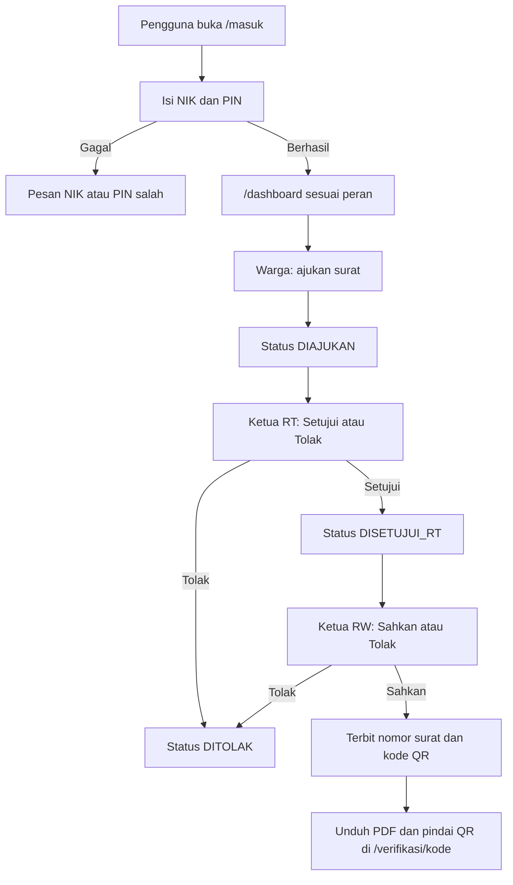

# SiWarga RT/RW

---

## 1. Ringkasan & Tujuan Aplikasi

- **Nama Aplikasi**: SiWarga RT/RW
- **Penjelasan Singkat**: Aplikasi web untuk mengelola data kependudukan, surat pengantar, iuran warga, dan kas RT serta RW dalam satu tempat. Surat disahkan secara berjenjang dan dapat diperiksa keasliannya lewat QR Code.
- **Masalah yang Diselesaikan**:
  - Data warga tersebar di buku tulis dan catatan pribadi pengurus, sehingga sulit dicari saat dibutuhkan.
  - Pengajuan surat pengantar harus datang langsung ke kantor RT dan RW, dan warga lansia atau yang tidak memegang perangkat sering kesulitan mengajukan.
  - Iuran dan kas RT tidak terbuka untuk warga, sehingga kecurigaan soal penggunaan dana sering muncul.
  - Keaslian surat yang dicetak sulit dibuktikan oleh instansi tujuan.
  - Setoran kas dari RT ke RW tidak tercatat berpasangan, sehingga selisih sulit ditelusuri.
- **Pengguna Aplikasi**:
  - Warga (Kepala Keluarga dan anggota terdaftar): mengelola anggota KK, mengajukan surat, mengonfirmasi iuran, melihat transparansi kas, membaca pengumuman, dan mengirim laporan atau aspirasi.
  - Pengurus RT (Ketua, Sekretaris, Bendahara RT): mengelola data kependudukan di wilayah RT-nya, menyetujui surat tahap pertama, memverifikasi iuran, mencatat kas RT, dan menyetor kas ke RW.
  - Pengurus RW (Ketua, Sekretaris, Bendahara RW): memantau data dan keuangan seluruh RT, mengesahkan surat tahap akhir, mengonfirmasi setoran kas, dan menerbitkan pengumuman lintas RW.
- **Target Keberhasilan**:
  - Seluruh surat pengantar dan keterangan yang diajukan tercatat, dapat dilacak statusnya, dan dapat dicetak dalam bentuk PDF resmi.
  - Setiap surat yang sudah disahkan dapat diperiksa keasliannya oleh pihak luar lewat pemindaian QR Code.
  - Setiap warga dapat melihat status iuran bulannya, serta saldo dan ringkasan kas RT dan RW.
  - Setiap setoran kas dari RT tercatat di dua sisi (pengeluaran RT dan penerimaan RW) dan terkonfirmasi oleh Bendahara RW.
  - Pengurus RT dapat mencari data warga dalam hitungan detik dengan NIK, No. KK, nama, atau blok/alamat.

---

## 2. Batasan Pembuatan Sistem (Versi Awal MVP)

### Yang Dikerjakan

- Masuk dengan NIK 16 digit dan PIN 6 digit yang disimpan terenkripsi (hash).
- Ubah PIN secara mandiri oleh pengguna.
- Reset PIN oleh Pengurus RT jika warga lupa PIN.
- Dashboard adaptif untuk Warga, Pengurus RT, dan Pengurus RW.
- Warga mengelola anggota dalam satu Kartu Keluarga (KK).
- Warga mengajukan surat pengantar dan keterangan.
- Mode asistensi: Pengurus input permohonan atas nama warga.
- Persetujuan berjenjang: Ketua RT menyetujui, lalu Ketua RW mengesahkan.
- Terbit nomor surat resmi dan kode QR setelah surat disahkan.
- Cetak dokumen PDF berkop RT/RW dengan blok tanda tangan digital berjenjang.
- Halaman verifikasi publik melalui pemindaian QR Code, yang menampilkan nomor surat dan status keaslian.
- Pencarian data berdasarkan NIK, No. KK, Nama, dan Blok/Alamat.
- Penyaringan data per wilayah RT dan status hunian Tetap atau Kontrak/Kos.
- Pengelompokan anggota berdasarkan Nomor KK.
- Mutasi kependudukan: AKTIF, PINDAH_KELUAR, MENINGGAL.
- Warga mengonfirmasi pembayaran iuran bulanan dengan bukti transfer.
- Bendahara RT memverifikasi iuran bulanan warga.
- Setoran kas wajib RT ke RW yang mencatat transaksi berpasangan.
- Bendahara RW mengonfirmasi penerimaan setoran kas dari RT.
- Laporan pemasukan, pengeluaran, dan saldo bersih yang dapat dilihat warga.
- Papan pengumuman lingkup RT dan lintas RW.
- Warga mengirim laporan keamanan wilayah dan aspirasi, yang diterima Pengurus RT.
- Tabel komparasi populasi dan saldo kas antar-RT untuk Pengurus RW.
- Integrasi WhatsApp berupa tombol bagikan ke WhatsApp dari pengumuman dan surat.
- Pendukung yang mutlak diperlukan agar butir di atas berjalan (alasan singkat):
  - Sesi masuk setelah login, agar setiap halaman tahu pengguna dan perannya (tanpa ini, tidak ada dashboard adaptif).
  - Pembuatan akun penduduk oleh Pengurus RT saat data warga ditambahkan, karena tidak ada pendaftaran mandiri dalam daftar fitur.
  - Penolakan surat dan iuran, agar alur persetujuan dan verifikasi bisa berhenti bila data tidak benar.
  - Batas percobaan PIN salah (5 kali, lalu terkunci 15 menit), sebagai pengamanan PIN 6 digit terhadap tebakan.
  - Penetapan peran pengurus (Ketua, Sekretaris, Bendahara RT dan RW) dilakukan langsung di database saat peluncuran, tanpa layar khusus.

### Yang Tidak Dikerjakan di Versi Awal

- Pembayaran iuran secara online (payment gateway). Pembayaran hanya melalui Transfer Bank sesuai pilihan user.
- Notifikasi WhatsApp otomatis. WhatsApp hanya berupa tombol bagikan manual.
- Pendaftaran akun mandiri oleh warga tanpa dibuatkan Pengurus RT.
- Semua fitur di luar daftar Yang Dikerjakan.

---

## 3. Daftar Halaman & Struktur Menu (Pages & Routing)

### A. Area Publik (Tanpa Login)

- `/masuk` (Halaman Masuk): Form NIK dan PIN. Setelah berhasil, pengguna diarahkan ke `/dashboard`.
- `/verifikasi/[kode]` (Verifikasi Surat): Menampilkan nomor surat dan status keaslian (ASLI atau TIDAK DITEMUKAN). Tidak menampilkan data pribadi pemohon.

### B. Area Warga (Login, Semua Peran)

Semua akun, termasuk Pengurus RT dan RW, dapat membuka halaman ini untuk data dirinya sendiri.

- `/dashboard` (Dashboard Warga): Status iuran bulan berjalan, status surat terakhir, saldo kas RT dan RW, dan 5 pengumuman terbaru.
- `/keluarga` (Anggota KK): Daftar anggota satu KK, tambah dan ubah anggota (khusus Kepala Keluarga).
- `/surat` (Riwayat Surat): Daftar pengajuan surat milik KK sendiri beserta statusnya.
- `/surat/baru` (Ajukan Surat): Form pengajuan surat pengantar dan keterangan.
- `/surat/[id]` (Detail Surat): Status alur persetujuan, tombol unduh PDF (hanya bila sudah disahkan), dan tombol Bagikan ke WhatsApp.
- `/iuran` (Iuran Saya): Riwayat iuran per periode dengan statusnya.
- `/iuran/baru` (Konfirmasi Pembayaran Iuran): Form periode, nominal, metode (Transfer Bank), dan unggah bukti transfer.
- `/kas` (Transparansi Kas): Ringkasan pemasukan, pengeluaran, dan saldo bersih kas RT dan RW, serta daftar transaksi kas RT.
- `/pengumuman` (Papan Pengumuman): Daftar pengumuman RT sendiri dan pengumuman lintas RW.
- `/pengumuman/[id]` (Detail Pengumuman): Isi pengumuman dan tombol Bagikan ke WhatsApp.
- `/laporan/baru` (Kirim Laporan): Form laporan keamanan wilayah atau aspirasi ke Pengurus RT.
- `/akun/pin` (Ubah PIN): Form ubah PIN mandiri.

### C. Area Pengurus RT (Login, Peran PENGURUS_RT)

- `/rt/penduduk` (Data Kependudukan): Pencarian (NIK, No. KK, Nama, Blok/Alamat), penyaringan status hunian, daftar dikelompokkan per No. KK.
- `/rt/kk/baru` (Tambah KK): Form data KK dan anggota pertama yang otomatis menjadi Kepala Keluarga.
- `/rt/penduduk/[id]` (Detail Penduduk): Ubah data, ubah status mutasi, dan reset PIN.
- `/rt/surat` (Antrean Surat RT): Daftar surat berstatus DIAJUKAN di wilayah RT, lalu aksi Setujui atau Tolak.
- `/rt/surat/baru` (Ajukan Surat Asistensi): Form pengajuan atas nama warga dengan mode asistensi.
- `/rt/surat/[id]` (Detail Surat RT): Isi permohonan, aksi Setujui atau Tolak.
- `/rt/iuran` (Antrean Verifikasi Iuran): Daftar iuran berstatus MENUNGGU_VERIFIKASI.
- `/rt/iuran/[id]` (Verifikasi Iuran): Lihat bukti transfer, aksi Verifikasi atau Tolak.
- `/rt/kas` (Buku Kas RT): Daftar seluruh transaksi kas RT dan saldo, serta tombol catat kas baru dan setoran.
- `/rt/kas/baru` (Catat Kas RT): Form pemasukan atau pengeluaran operasional.
- `/rt/kas/setoran/baru` (Setoran Kas ke RW): Form setoran yang otomatis mencatat pengeluaran RT.
- `/rt/pengumuman` (Pengumuman RT): Daftar pengumuman RT dan tombol buat baru.
- `/rt/pengumuman/baru` (Buat Pengumuman RT): Form pengumuman lingkup RT.
- `/rt/laporan` (Kotak Laporan Warga): Daftar laporan keamanan dan aspirasi dari warga RT, serta detailnya.

### D. Area Pengurus RW (Login, Peran PENGURUS_RW)

- `/rw/surat` (Antrean Pengesahan): Daftar surat berstatus DISETUJUI_RT dari seluruh RT, lalu aksi Sahkan atau Tolak.
- `/rw/surat/[id]` (Detail Pengesahan): Isi permohonan, riwayat persetujuan RT, aksi Sahkan atau Tolak.
- `/rw/setoran` (Konfirmasi Setoran): Antrean setoran MENUNGGU_KONFIRMASI dan riwayat setoran TERKONFIRMASI.
- `/rw/rekap` (Rekap Antar-RT): Tabel komparasi populasi dan saldo kas per RT.
- `/rw/pengumuman` (Pengumuman Lintas RW): Daftar pengumuman lintas RW dan form buat baru.

*Catatan: Tidak ada halaman Tentang, FAQ, Kebijakan, atau area lain di luar daftar di atas.*

---

## 4. Pedoman UI/UX & Design System

- **Skema Warna**: Warna brand hijau teal `#0E6B5C` (HSL sekitar 172 75% 24%). Skala turunan: 50 `#EEF8F6`, 100 `#D2EEE9`, 300 `#7CC7B8`, 500 `#2E9583`, 700 `#0E6B5C`, 900 `#063B33`. Netral sedikit kehijauan: latar `#F6F8F7`, teks utama `#1B2623`, teks sekunder `#5B6B66`, garis `#DDE5E2`. Warna status saja: sukses `#15803D`, peringatan `#B45309`, error `#B91C1C`.
- **Tipografi**: Satu keluarga font, Plus Jakarta Sans, untuk heading dan body. H1 desktop 36px (line-height 1.2), H2 24px, H3 18px, body 16px (line-height 1.6), teks kecil 14px. Lebar baris maksimal sekitar 70 karakter.
- **Aturan Komponen**: Radius tombol 8px, input 8px, kartu 12px. Bayangan hanya `shadow-sm` pada kartu, tombol tanpa bayangan. Hover hanya pada elemen yang bisa diklik (tombol, baris tabel yang membuka detail, tautan). Tabel data memakai garis pemisah tipis, bukan kartu per baris.
- **Nuansa & Vibe**: Kantor RT yang tertib dan terbuka, dengan angka dan tanda tangan yang mudah dibaca warga biasa di layar ponsel.
- **Larangan UI (aturan untuk proyek ini)**:
  - Jangan pakai gradien ungu-biru, gradien teks, atau glow neon. Isi solid warna brand sudah cukup.
  - Jangan menambah warna aksen kedua. Gunakan skala brand 50 sampai 900, dan warna status hanya untuk status nyata.
  - Jangan membuat ukuran judul dan body hampir sama. Ikuti lompatan ukuran pada poin Tipografi.
  - Jangan menyusun fitur sebagai tiga kartu identik. Pada dashboard, gunakan satu kartu besar saldo dan dua kartu kecil, atau daftar biasa.
  - Jangan memakai emoji atau ikon sparkle. Gunakan satu set ikon konsisten, yaitu Lucide.
  - Jangan membuat ilustrasi palsu dari div kosong. Gunakan data dummy yang tampil di tabel nyata.
  - Jangan memakai kata pengisi seperti "revolusioner", "seamless", "unlock", atau "elevate". Gunakan kalimat konkret, misalnya "Ajukan surat dalam 3 langkah".
  - Jangan memakai em-dash atau en-dash di teks UI. Gunakan tanda hubung biasa, koma, titik dua, atau kalimat baru.
  - Jangan memakai Lorem Ipsum, nama generik, avatar inisial, atau angka palsu. Gunakan data dummy realistis (lihat Bab 9).
  - Jangan memaksakan animasi. Setiap animasi wajib punya fallback `prefers-reduced-motion` yang tampil instan.
  - Setiap komponen interaktif wajib punya state hover, focus yang terlihat, active, disabled, loading, empty, dan error.
  - Tampilan wajib nyaman di ponsel. Menu samping berubah menjadi drawer di layar kecil, dan tabel berubah menjadi daftar kartu di layar sempit.

---

## 5. Pembagian Hak Akses Pengguna

Aplikasi ini bersifat privat. Hanya area publik (halaman masuk dan verifikasi surat) yang dapat diakses tanpa login.

| Menu / Halaman | Publik (Tanpa Login) | Warga (Login) | Pengurus RT (Login) | Pengurus RW (Login) |
| :--- | :---: | :---: | :---: | :---: |
| Masuk dan Verifikasi Surat | Ya | Ya | Ya | Ya |
| Dashboard, Anggota KK, Surat Saya, Iuran Saya, Ubah PIN | Tidak | Ya | Ya | Ya |
| Transparansi Kas, Papan Pengumuman, Kirim Laporan | Tidak | Ya | Ya | Ya |
| Data Kependudukan RT, Reset PIN, Mutasi | Tidak | Tidak | Ya, hanya RT sendiri | Tidak |
| Antrean Surat RT (Setujui atau Tolak) | Tidak | Tidak | Ya, hanya RT sendiri | Tidak |
| Antrean Verifikasi Iuran dan Buku Kas RT | Tidak | Tidak | Ya, hanya RT sendiri | Tidak |
| Kotak Laporan Warga | Tidak | Tidak | Ya, hanya RT sendiri | Tidak |
| Pengumuman RT | Tidak | Tidak | Ya, hanya RT sendiri | Tidak |
| Antrean Pengesahan Surat (Sahkan atau Tolak) | Tidak | Tidak | Tidak | Ya, seluruh RT |
| Konfirmasi Setoran Kas | Tidak | Tidak | Tidak | Ya |
| Rekap Antar-RT | Tidak | Tidak | Tidak | Ya |
| Pengumuman Lintas RW | Tidak | Tidak | Tidak | Ya |

*Catatan: Akun Pengurus RT dan RW juga memiliki seluruh fitur Warga untuk data dirinya sendiri, karena setiap pengurus tetap tinggal di wilayahnya. Jabatan dalam pengurus (Ketua, Sekretaris, Bendahara) menentukan aksi mana yang boleh dilakukan (lihat Bab 6, bagian Aturan Peran).*

---

## 6. Alur Kerja dan Fitur Utama

### A. Masuk dan Keamanan Akun

1. **Cara Kerja**:
   1. Pengguna membuka `/masuk`, mengisi NIK 16 digit dan PIN 6 digit.
   2. Sistem mencari NIK. Jika ditemukan, sistem memeriksa PIN dengan membandingkan hash.
   3. Jika berhasil, sistem membuat sesi dan mengarahkan ke `/dashboard`.
   4. Jika gagal, sistem menampilkan pesan umum "NIK atau PIN salah" tanpa menyebut bagian mana yang salah.
2. **Aturan Sistem**:
   - NIK harus tepat 16 digit angka dan terdaftar. PIN harus tepat 6 digit angka.
   - PIN disimpan dalam bentuk hash `Utilities.computeDigest` (SHA-256 teriterasi dengan salt unik per pengguna), tidak pernah disimpan atau ditampilkan dalam bentuk teks biasa.
   - Setelah 5 kali PIN salah berturut-turut, akun terkunci selama 15 menit. Reset PIN oleh Pengurus RT membuka kunci.
   - Penduduk dengan status mutasi PINDAH_KELUAR atau MENINGGAL tidak dapat masuk.
   - Sesi berlaku 8 jam menggunakan token sesi yang disimpan di `sessionStorage` browser dan divalidasi di server melalui `CacheService` serta Sheet `Sesi`. Pengguna dapat keluar lewat tombol Keluar di menu.
   - Ubah PIN (`/akun/pin`): pengguna mengisi PIN lama, PIN baru 6 digit, dan konfirmasi PIN baru. PIN baru harus sama dengan konfirmasi dan tidak boleh sama dengan PIN lama.
   - Reset PIN (`/rt/penduduk/[id]`): Pengurus RT hanya dapat mereset PIN penduduk di RT-nya. Sistem membuat PIN sementara 6 digit acak dan menampilkannya satu kali kepada Pengurus. PIN lama tidak berlaku lagi. Warga dapat mengganti PIN sementara tersebut lewat Ubah PIN.
   - Akun baru dibuat ketika Pengurus RT menambahkan penduduk. PIN awalnya dibuat dengan cara yang sama seperti reset PIN, dan diberikan kepada warga secara langsung.

### B. Dashboard Adaptif

1. **Cara Kerja**: Setelah masuk, `/dashboard` menampilkan isi sesuai peran. Seluruh angka dihitung dari data nyata, bukan angka tetap.
2. **Aturan Sistem**:
   - Tampilan Warga:
     - Status iuran bulan berjalan: BELUM_BAYAR bila belum ada pengajuan untuk periode itu, atau status terakhir (MENUNGGU_VERIFIKASI, TERVERIFIKASI, DITOLAK).
     - Status surat aktif: surat terakhir milik KK yang belum berstatus DISAHKAN_RW atau DITOLAK. Jika tidak ada, tampilkan "Tidak ada surat yang sedang diproses".
     - Saldo kas RT dan saldo kas RW.
     - 5 pengumuman terbaru.
   - Tampilan Pengurus RT:
     - Jumlah KK di RT.
     - Jumlah jiwa dengan status AKTIF, dipisah menjadi Tetap dan Kontrak/Kos.
     - Jumlah surat berstatus DIAJUKAN di RT.
     - Jumlah iuran berstatus MENUNGGU_VERIFIKASI di RT.
     - Saldo kas RT.
   - Tampilan Pengurus RW:
     - Jumlah KK dan jiwa AKTIF se-RW.
     - Jumlah surat berstatus DISETUJUI_RT (antrean pengesahan).
     - Jumlah setoran berstatus MENUNGGU_KONFIRMASI.
     - Tabel komparasi ringkas (lihat Bagian K).
   - Saldo RT = total PEMASUKAN dikurangi total PENGELUARAN pada kas RT. Setoran ke RW sudah tercatat sebagai PENGELUARAN saat disimpan.
   - Saldo RW = total setoran berstatus TERKONFIRMASI.

### C. Manajemen Kependudukan dan Kartu Keluarga (KK)

1. **Cara Kerja**:
   1. Pengurus RT membuka `/rt/kk/baru`, mengisi data KK (No. KK, alamat, blok, status hunian), lalu data kepala keluarga sebagai anggota pertama.
   2. Pengurus RT menambah anggota lain lewat `/rt/penduduk` atau detail KK.
   3. Kepala Keluarga dapat menambah dan mengubah data anggota KK-nya lewat `/keluarga`.
   4. Pengurus RT mencari dan menyaring data di `/rt/penduduk`, lalu membuka detail untuk mengubah data atau mutasi.
2. **Aturan Sistem**:
   - NIK wajib 16 digit angka dan unik di seluruh database. No. KK wajib 16 digit angka dan unik.
   - Nama wajib 3 sampai 150 karakter. Tanggal lahir tidak boleh di masa depan.
   - Jenis kelamin wajib L atau P. Hubungan keluarga wajib salah satu dari KEPALA_KELUARGA, SUAMI, ISTRI, ANAK, MENANTU, ORANG_TUA, atau FAMILI_LAIN.
   - Alamat wajib diisi. Blok wajib diisi, maksimal 20 karakter.
   - Status hunian KK wajib TETAP atau KONTRAK_KOS.
   - Setiap KK wajib memiliki tepat satu Kepala Keluarga dengan status AKTIF.
   - Pencarian mencocokkan NIK (sama persis atau diawali angka yang diketik), No. KK (sama persis), Nama (mengandung kata, tidak peka huruf besar kecil), dan Blok/Alamat (mengandung kata).
   - Penyaringan wilayah RT: Pengurus RT hanya melihat RT-nya. Pengurus RW dapat memilih RT dari daftar RT se-RW.
   - Penyaringan status hunian: Tetap atau Kontrak/Kos.
   - Daftar dikelompokkan per No. KK. Setiap KK tampil sebagai satu blok dengan anggotanya di bawahnya.
   - Mutasi kependudukan: AKTIF, PINDAH_KELUAR, atau MENINGGAL. Hanya Pengurus RT di RT yang bersangkutan yang dapat mengubah mutasi.
   - Penduduk dengan mutasi selain AKTIF tidak dihitung dalam statistik jiwa, tidak dapat masuk, dan tidak dapat diajukan surat baru. Datanya tetap tersimpan.

### D. Layanan Surat Pengantar dan Keterangan Berjenjang (dengan Validasi QR)

1. **Cara Kerja**:
   1. Warga membuka `/surat/baru`, memilih jenis surat, memilih pemohon dari anggota KK-nya, dan mengisi keperluan.
   2. Sistem membuat pengajuan dengan status DIAJUKAN.
   3. Ketua RT membuka `/rt/surat`, memeriksa data, lalu memilih Setujui atau Tolak. Jika Setujui, status menjadi DISETUJUI_RT.
   4. Ketua RW membuka `/rw/surat`, memeriksa data dan persetujuan RT, lalu memilih Sahkan atau Tolak. Jika Sahkan, sistem menerbitkan nomor surat dan kode verifikasi, dan status menjadi DISAHKAN_RW.
   5. Warga atau Pengurus mengunduh PDF dari `/surat/[id]`. PDF dapat diunduh hanya setelah status DISAHKAN_RW.
   6. Mode asistensi: Pengurus RT (Ketua atau Sekretaris) membuka `/rt/surat/baru`, memilih pemohon dari RT-nya, dan mengisi permohonan. Pengajuan ditandai mode asistensi dan dicatat atas nama Pengurus yang menginput.
2. **Aturan Sistem**:
   - Jenis surat (kode dan label):
     - PENGANTAR_UMUM (Pengantar Umum/Kelurahan)
     - KETERANGAN_DOMISILI (Keterangan Domisili, SKD)
     - KETERANGAN_USAHA (Keterangan Usaha, SKU)
     - KETERANGAN_TIDAK_MAMPU (Keterangan Tidak Mampu, SKTM)
     - PENGANTAR_SKCK (Pengantar SKCK)
     - PENGANTAR_NIKAH (Pengantar Nikah, formulir N1 sampai N4)
     - KETERANGAN_KELAHIRAN_KEMATIAN (Keterangan Kelahiran/Kematian)
   - Keperluan wajib diisi, 10 sampai 500 karakter.
   - Pemohon wajib berstatus mutasi AKTIF dan berada di KK yang sama dengan pengguna yang mengajukan (warga), atau di RT yang sama (pengurus asistensi).
   - Status surat dan urutannya (sumber kebenaran untuk seluruh dokumen):
     - DIAJUKAN, lalu DISETUJUI_RT (oleh Ketua RT) atau DITOLAK.
     - DISETUJUI_RT, lalu DISAHKAN_RW (oleh Ketua RW) atau DITOLAK.
     - DITOLAK dan DISAHKAN_RW bersifat final. Surat yang ditolak wajib memiliki alasan 10 sampai 300 karakter.
   - Hanya surat berstatus DIAJUKAN yang dapat disetujui atau ditolak oleh Ketua RT di RT tersebut.
   - Hanya surat berstatus DISETUJUI_RT yang dapat disahkan atau ditolak oleh Ketua RW.
   - Format nomor surat: `[urut 3 digit]/RT.[nomor RT 3 digit]/RW.[nomor RW 3 digit]/[bulan romawi]/[tahun]`. Contoh: `045/RT.003/RW.007/IV/2025`.
   - Nomor urut dihitung per RW dan per tahun, mulai dari 001, dan dibuat hanya saat pengesahan RW.
   - Kode verifikasi: 16 karakter huruf besar dan angka acak, unik, dibuat saat pengesahan RW. Kode ini menjadi isi QR Code.
   - Blok tanda tangan digital pada PDF, berurutan:
     - Ketua RT: nama, jabatan, dan tanggal persetujuan.
     - Ketua RW: nama, jabatan, dan tanggal pengesahan, dengan keterangan "Ditandatangani secara elektronik".
   - PDF dibuat di `code.gs` melalui konversi HTML-to-PDF (`Blob.getAs('application/pdf')`) dan memuat kop RT dan RW (nomor RT, nomor RW, nama kelurahan dari Sheet `RT` dan `RW`), nomor surat, jenis surat, data pemohon (nama, NIK, tempat dan tanggal lahir, alamat), keperluan, blok tanda tangan, serta QR Code SVG inline yang mengarah ke `?page=verifikasi&kode=KODE` (`/verifikasi/[kode]`).
   - Halaman verifikasi publik `?page=verifikasi&kode=KODE` (`/verifikasi/[kode]`) menampilkan hanya:
     - Nomor surat, dan status keaslian ASLI bila surat berstatus DISAHKAN_RW.
     - Pesan TIDAK DITEMUKAN bila kode tidak cocok atau surat belum disahkan.
   - Halaman verifikasi tidak menampilkan nama, NIK, atau alamat pemohon.

### E. Iuran Bulanan Warga dan Verifikasi Bendahara RT

1. **Cara Kerja**:
   1. Warga membuka `/iuran/baru`, memilih periode bulan, mengisi nominal, memilih metode Transfer Bank, dan mengunggah bukti transfer.
   2. Sistem menyimpan pengajuan dengan status MENUNGGU_VERIFIKASI.
   3. Bendahara RT membuka `/rt/iuran`, membuka detail, melihat bukti, lalu memilih Verifikasi atau Tolak.
   4. Jika Verifikasi, sistem mencatat pemasukan di kas RT dengan kategori "Iuran Warga" dan status menjadi TERVERIFIKASI.
   5. Jika Tolak, warga dapat mengajukan ulang untuk periode yang sama.
2. **Aturan Sistem**:
   - Periode wajib dalam format `YYYY-MM`, tidak boleh lebih dari bulan berjalan.
   - Metode bayar hanya TRANSFER_BANK.
   - Nominal wajib angka bulat, minimal Rp 1.000 dan maksimal Rp 5.000.000.
   - Bukti transfer wajib diunggah, format JPG, PNG, atau PDF, ukuran maksimal 2 MB.
   - Satu KK hanya boleh memiliki satu pengajuan aktif (MENUNGGU_VERIFIKASI atau TERVERIFIKASI) per periode.
   - Status iuran: MENUNGGU_VERIFIKASI, TERVERIFIKASI, DITOLAK.
   - Alasan penolakan wajib diisi, 10 sampai 300 karakter.
   - Bukti transfer disimpan di folder Google Drive privat dan hanya dapat diakses lewat fungsi pemeriksaan hak akses di `code.gs` oleh anggota KK yang bersangkutan dan Pengurus RT di RT tersebut.
   - Status BELUM_BAYAR bukan disimpan di database. Status ini ditampilkan bila tidak ada pengajuan untuk periode berjalan.

### F. Setoran Kas Wajib RT ke RW

1. **Cara Kerja**:
   1. Bendahara RT membuka `/rt/kas/setoran/baru`, mengisi tanggal dan nominal setoran.
   2. Sistem menyimpan dua catatan secara atomik dengan penguncian `LockService.getScriptLock()`:
     - Di buku kas RT: pengeluaran berkategori "Setoran ke RW".
     - Di antrean RW: setoran berstatus MENUNGGU_KONFIRMASI.
   1. Bendahara RW membuka `/rw/setoran`, memeriksa setoran, lalu memilih Konfirmasi.
   2. Setelah dikonfirmasi, status setoran menjadi TERKONFIRMASI dan saldo kas RW bertambah.
2. **Aturan Sistem**:
   - Nominal setoran wajib angka bulat, minimal Rp 1.000, dan tidak boleh melebihi saldo kas RT saat ini.
   - Tanggal setoran tidak boleh di masa depan.
   - Setoran berstatus MENUNGGU_KONFIRMASI tidak mengurangi saldo RW, tetapi sudah mengurangi saldo RT.
   - Status setoran: MENUNGGU_KONFIRMASI dan TERKONFIRMASI. Setelah dikonfirmasi, setoran tidak dapat diubah.
   - Buku kas RW berisi seluruh setoran RT se-RW, dengan status masing-masing.

### G. Pencatatan Kas Operasional RT dan Laporan Transparansi

1. **Cara Kerja**:
   1. Bendahara RT membuka `/rt/kas/baru`, memilih jenis PEMASUKAN atau PENGELUARAN, mengisi kategori, nominal, dan keterangan.
   2. Sistem menyimpan transaksi dan memperbarui saldo RT.
   3. Warga membuka `/kas` untuk melihat ringkasan dan daftar transaksi kas RT, serta ringkasan kas RW.
2. **Aturan Sistem**:
   - Jenis kas: PEMASUKAN atau PENGELUARAN.
   - Kategori wajib diisi, 3 sampai 60 karakter. Keterangan opsional, maksimal 300 karakter.
   - Nominal wajib angka bulat, minimal Rp 1.000. Pengeluaran tidak boleh melebihi saldo RT saat ini.
   - Transaksi yang berasal dari iuran (TERVERIFIKASI) atau setoran ke RW bersifat otomatis dan tidak dapat diubah dari halaman catat kas.
   - Ringkasan pada `/kas` menampilkan: total pemasukan, total pengeluaran, dan saldo bersih, untuk kas RT dan kas RW.
   - Daftar transaksi kas RT ditampilkan terbaru di atas, dengan batas 20 baris per halaman.
   - Warga hanya dapat membaca transparansi kas, tidak dapat mengubah.

### H. Papan Pengumuman Lingkup RT dan Lintas RW

1. **Cara Kerja**:
   1. Ketua atau Sekretaris RT membuat pengumuman di `/rt/pengumuman/baru` dengan lingkup RT.
   2. Pengurus RW membuat pengumuman di `/rw/pengumuman` dengan lingkup LINTAS_RW.
   3. Warga melihat pengumuman di `/pengumuman` dan membuka detail di `/pengumuman/[id]`.
2. **Aturan Sistem**:
   - Judul wajib 5 sampai 150 karakter. Isi wajib 10 sampai 3.000 karakter.
   - Lingkup: RT (hanya untuk warga di RT yang membuat) atau LINTAS_RW (untuk seluruh warga di RW).
   - Pengumuman diurutkan dari yang terbaru.

### I. Laporan Keamanan Wilayah dan Aspirasi Warga

1. **Cara Kerja**:
   1. Warga membuka `/laporan/baru`, memilih jenis KEAMANAN atau ASPIRASI, lalu mengisi judul dan isi.
   2. Sistem menyimpan laporan dan mengarahkannya ke RT pelapor.
   3. Pengurus RT membuka `/rt/laporan` untuk membaca daftar dan detail laporan.
2. **Aturan Sistem**:
   - Laporan hanya diterima oleh Pengurus RT di RT pelapor. Pengurus RW tidak menerima laporan ini.
   - Judul wajib 5 sampai 150 karakter. Isi wajib 10 sampai 2.000 karakter.
   - Jenis laporan: KEAMANAN atau ASPIRASI.
   - Tidak ada status penanganan laporan dalam versi awal. Laporan hanya dapat dibaca.

### J. Integrasi WhatsApp (Tombol Bagikan)

1. **Cara Kerja**: Pada halaman detail pengumuman dan detail surat yang sudah disahkan, pengguna menekan tombol Bagikan ke WhatsApp. Sistem membuka WhatsApp dengan teks yang sudah terisi.
2. **Aturan Sistem**:
   - Teks pengumuman berisi judul dan 200 karakter pertama isi, diikuti tautan ke halaman `/pengumuman/[id]`.
   - Teks surat berisi jenis surat, nomor surat, dan tautan ke `?page=verifikasi&kode=KODE`.
   - Tombol hanya tampil untuk surat berstatus DISAHKAN_RW. Tidak ada pengiriman otomatis.
   - Tautan dibuat dengan format `https://wa.me/?text=` agar bekerja di ponsel maupun komputer.

### K. Komparasi Populasi dan Saldo Kas Antar-RT (Pengurus RW)

1. **Cara Kerja**: Pengurus RW membuka `/rw/rekap` untuk melihat tabel komparasi.
2. **Aturan Sistem**:
   - Kolom tabel: Nomor RT, Jumlah KK, Jiwa AKTIF, Jiwa Tetap, Jiwa Kontrak/Kos, dan Saldo Kas RT.
   - Baris diurutkan dari nomor RT terkecil.
   - Hanya data penduduk berstatus AKTIF yang dihitung sebagai jiwa.
   - Saldo kas RT dihitung dengan aturan pada Bagian B.

---

## 7. Alur Navigasi & Arsitektur Layout

### Arsitektur Layout (Persisten)

- **Layout Publik**: Dipakai oleh `/masuk` dan `/verifikasi/[kode]`. Berisi header sederhana dengan logo teks "SiWarga RT/RW" dan konten di tengah. Tidak ada menu navigasi dan tidak ada footer panjang.
- **Layout Aplikasi**: Dipakai oleh seluruh halaman setelah login.
  - Header berisi nama aplikasi, nama RT dan RW pengguna, serta nama dan peran pengguna dengan tombol Keluar.
  - Menu samping (sidebar) di desktop. Menu berubah menjadi drawer di ponsel.
  - Menu Warga selalu tampil. Menu tambahan muncul sesuai peran:
    - Pengurus RT: grup menu "Pengurus RT" (Penduduk, Surat, Iuran, Kas, Pengumuman, Laporan).
    - Pengurus RW: grup menu "Pengurus RW" (Surat, Setoran, Rekap, Pengumuman).
  - Area konten maksimal lebar 1.200px di desktop, dengan padding 16px di ponsel.

### Bagan Alur (Flowchart)



---

## 8. Kebutuhan Non-Fungsional (SEO, Keamanan, & Performa)

- **SEO**: Aplikasi bersifat privat, sehingga `index.html` wajib memakai meta tag `noindex, nofollow`. Halaman publik `/masuk` dan `?page=verifikasi&kode=KODE` (`/verifikasi/[kode]`) juga memakai `noindex`, karena keduanya tidak ditujukan untuk mesin pencari.
  - Title dinamis per halaman: "[Nama Halaman] | SiWarga RT/RW".
  - Meta description untuk `/masuk`: "Masuk ke SiWarga RT/RW untuk layanan administrasi warga RT dan RW."
  - Open Graph tidak diwajibkan karena tautan verifikasi hanya dibagikan secara pribadi.
- **Keamanan**:
  - Seluruh komunikasi melalui HTTPS bawaan Google Apps Script Web App.
  - PIN di-hash dengan `Utilities.computeDigest` (SHA-256 teriterasi dengan salt unik per pengguna). PIN tidak pernah dikirim balik ke browser, kecuali PIN sementara yang ditampilkan satu kali saat reset.
  - Token sesi acak disimpan di `sessionStorage` pada sisi klien dan divalidasi di server (`code.gs`) melalui `CacheService` serta Sheet `Sesi` dengan masa berlaku 8 jam.
  - Batas percobaan PIN: 5 kali salah berturut-turut mengunci akun selama 15 menit, dan penduduk dengan `statusMutasi` selain `AKTIF` diblokir dari login (lihat Bab 6 bagian A).
  - Setiap fungsi server di `code.gs` (`google.script.run`) memvalidasi token sesi, peran, dan wilayah RT pengguna. Pengurus RT tidak dapat membuka data RT lain dengan memodifikasi parameter (pencegahan IDOR).
  - Seluruh input divalidasi ulang di server (`code.gs`) sebelum ditulis ke Google Sheets, termasuk aturan Bab 6.
  - Unggahan bukti transfer diperiksa tipe MIME dan ukurannya di server, disimpan ke folder Google Drive privat via `DriveApp`, dan diakses hanya lewat fungsi pemeriksaan hak akses di `code.gs`.
  - Teks dari pengguna (keperluan, laporan, pengumuman) di-escape dan ditampilkan sebagai teks biasa, tidak dirender sebagai HTML mentah.
  - Halaman verifikasi (`?page=verifikasi&kode=KODE`) tidak mengembalikan data pribadi (lihat Bab 6 bagian D).
- **Performa**:
  - Daftar data dimuat per 20 baris dengan paginasi sederhana (Sebelumnya dan Berikutnya).
  - Pencarian, penyaringan, dan pembacaan data dijalankan di server (`code.gs`) memakai `getDisplayValues()` dengan pemetaan kolom `const COL`, didukung cache memori di browser untuk perpindahan menu cepat serta `CacheService` di server.
  - Gambar bukti transfer dimuat saat diminta (lazy loading) melalui `code.gs` dan tidak diproses ulang di browser.
  - PDF dibuat di server (`code.gs`) saat diminta lewat HTML-to-PDF (`Blob.getAs('application/pdf')`) dengan QR SVG inline, tidak disimpan ulang, dan memakai data terbaru.
  - Penulisan data transaksi penting (penomoran surat, verifikasi iuran, setoran kas) dilindungi `LockService.getScriptLock()` dan diakhiri `SpreadsheetApp.flush()` agar angka agregat dashboard dan rekap selalu konsisten.

---

## 9. Panduan Bahasa, Copywriting, & Data Dummy

- **Gaya Bahasa**: Sopan, ringkas, dan membumi. Gunakan kata "Anda" untuk warga dan kata "Kami" untuk pihak pengelola RT dan RW. Kalimat tombol memakai kata kerja jelas: "Ajukan Surat", "Setujui", "Sahkan", "Verifikasi", "Konfirmasi Setoran".
- **Instruksi Data Dummy**: JANGAN PERNAH MENGGUNAKAN "Lorem Ipsum". Gunakan data dummy berbahasa Indonesia yang relevan. Contoh untuk entitas utama:
  - Wilayah: RW 007, RT 003 dan RT 004, Kelurahan Mekarjaya, Kecamatan Sukasari.
  - Penduduk:
    - Bambang Setiawan, NIK 3271010506800012, Kepala Keluarga, Tetap, KK 3271011203150021, Blok C4 No. 12.
    - Ratna Sari, NIK 3271014407850031, Istri, KK sama, AKTIF.
    - Dedi Kurniawan, NIK 3271012009010044, Kontrak/Kos, Blok F2 No. 5, KK 3271015510190007, Kepala Keluarga.
    - Siti Aminah, NIK 3271016002450018, Orang Tua, Tetap, MENINGGAL (contoh mutasi).
  - Surat contoh: `045/RT.003/RW.007/IV/2025`, jenis SKTM, keperluan "Pengajuan bantuan biaya pengobatan anak di puskesmas".
  - Iuran contoh: periode `2025-04`, nominal Rp 50.000, bukti transfer `bukti-bca-0412.jpg`.
  - Kas contoh: "Iuran Warga" Rp 50.000 (PEMASUKAN), "Setoran ke RW" Rp 1.200.000 (PENGELUARAN), "Pengecatan pos ronda" Rp 350.000 (PENGELUARAN).
  - Pengumuman contoh: "Kerja Bakti Minggu Pagi" di RT 003, dan "Jadwal Penyemprotan Nyamuk se-RW" sebagai LINTAS_RW.
  - Laporan contoh: "Lampu jalan gang mati" (ASPIRASI) dan "Motor hilang di depan Blok C" (KEAMANAN).

---

## 10. Fondasi Teknis (Untuk Tim Pengembang / Programmer & AI)

- **Arsitektur & Runtime**: Full Google Apps Script (GAS) Web App Modular menggunakan runtime V8 (`appsscript.json` dengan `timeZone: "Asia/Jakarta"`, `executeAs: "USER_DEPLOYING"`, dan `access: "ANYONE_ANONYMOUS"`).
- **Struktur File Modular**:
  - `appsscript.json`: Manifest runtime V8, zona waktu, dan konfigurasi Web App.
  - `code.gs`: Entry point `doGet(e)` (meneruskan parameter `?page` dan `?kode` ke template `index`), helper `include(filename)`, seluruh fungsi backend yang dipanggil via `google.script.run`, manajemen sesi, validasi hak akses, konversi PDF, dan akses Drive privat.
  - `setup.gs`: Definisi `SHEET_NAMES` (11 tab tanpa underscore), konstanta pemetaan indeks kolom `const COL`, serta fungsi `setupDatabase()` untuk inisialisasi dan migrasi skema non-destruktif beserta seed awal.
  - `index.html`: Shell SPA utama yang memuat font Plus Jakarta Sans, tag meta `noindex, nofollow`, `<style>` melalui `<?!= include('styles'); ?>`, kontainer `#layout-public` dan `#layout-app`, serta menyertakan partial modular lewat `include()` (`data_dummy`, `views_publik`, `views_warga`, `views_rt`, `views_rw`, `app_js`).
- **Styling & Komponen UI**: Pure CSS Design Tokens di `styles.html` (tanpa framework CSS eksternal), Google Fonts `Plus Jakarta Sans`, dan set ikon Lucide SVG inline di `app_js.html`. Token warna, tipografi, radius, dan aturan UI mengikuti Bab 4.
- **Autentikasi & Manajemen Sesi**: Solusi kustom NIK dan PIN. PIN di-hash di `code.gs` menggunakan `Utilities.computeDigest` (SHA-256 teriterasi dengan salt unik per pengguna). Token sesi acak disimpan di `sessionStorage` browser dan divalidasi di server melalui `CacheService` serta Sheet `Sesi` (kedaluwarsa 8 jam, kunci 15 menit setelah 5 kali gagal, blokir mutasi non-AKTIF).
- **Database**: Google Sheets dengan 11 tab tanpa karakter underscore (`RW`, `RT`, `KartuKeluarga`, `Penduduk`, `PengajuanSurat`, `Iuran`, `SetoranKas`, `KasRT`, `Pengumuman`, `LaporanWarga`, `Sesi`). Pembacaan memakai `getDisplayValues()` dengan pemetaan indeks kolom `const COL` (bukan nama string header). Penulisan transaksional memakai `LockService.getScriptLock()` dan diakhiri `SpreadsheetApp.flush()`. Format waktu resmi memakai `Utilities.formatDate(new Date(), 'Asia/Jakarta', 'yyyy-MM-dd HH:mm:ss')`.
- **Penyimpanan Berkas**: Google Drive melalui `DriveApp` menggunakan folder privat khusus bukti transfer. Berkas tidak diberi tautan publik; akses pratinjau hanya lewat fungsi `code.gs` yang memverifikasi hak akses KK atau Pengurus RT terkait.
- **PDF & QR Code**: Pembuatan PDF di `code.gs` melalui konversi HTML-to-PDF menggunakan `Blob.getAs('application/pdf')` yang dikirim sebagai payload base64 ke klien, dilengkapi QR Code SVG inline yang mengarah ke `?page=verifikasi&kode=KODE`.
- **Hosting & Preview Mode**: Dihosting langsung sebagai Google Apps Script Web App (HTTPS bawaan Google). Di sisi frontend (`app_js.html`), pemeriksaan `typeof google !== 'undefined' && google.script && google.script.run` mendukung Safe Preview Mode untuk pengujian UI Tahap 1 dengan `data_dummy.html`.
- **Konfigurasi Wilayah & Script Properties**: Nomor RT, nomor RW, dan nama kelurahan disimpan di Sheet `RW` dan `RT`, bukan di kode. Konfigurasi rahasia/lingkungan (`SPREADSHEET_ID`, `DRIVE_FOLDER_BUKTI_ID`, `WEBAPP_URL`, `PIN_PEPPER`) disimpan di `PropertiesService.getScriptProperties()`, tanpa file `.env`.

### Struktur Skema Database Nyata (Google Sheets & `const COL`)

*(Seluruh nama tab dilarang memakai karakter underscore `_`. Didefinisikan di `setup.gs` sebagai `SHEET_NAMES` dan `COL` dengan indeks array berbasis 0.)*

1. **Enum & Nilai Baku Sistem**:
   - `role`: `WARGA`, `PENGURUS_RT`, `PENGURUS_RW`
   - `statusHunian`: `TETAP`, `KONTRAK_KOS`
   - `statusMutasi`: `AKTIF`, `PINDAH_KELUAR`, `MENINGGAL`
   - `jenisSurat`: `PENGANTAR_UMUM`, `KETERANGAN_DOMISILI`, `KETERANGAN_USAHA`, `KETERANGAN_TIDAK_MAMPU`, `PENGANTAR_SKCK`, `PENGANTAR_NIKAH`, `KETERANGAN_KELAHIRAN_KEMATIAN`
   - `statusSurat`: `DIAJUKAN`, `DISETUJUI_RT`, `DISAHKAN_RW`, `DITOLAK`
   - `statusIuran`: `MENUNGGU_VERIFIKASI`, `TERVERIFIKASI`, `DITOLAK`
   - `jenisKas`: `PEMASUKAN`, `PENGELUARAN`
   - `statusSetoran`: `MENUNGGU_KONFIRMASI`, `TERKONFIRMASI`
   - `lingkupPengumuman`: `RT`, `LINTAS_RW`
   - `jenisLaporan`: `KEAMANAN`, `ASPIRASI`

2. **Pemetaan Kolom (`const COL`) per Tab Sheet**:

```javascript
const SHEET_NAMES = {
  RW: 'RW',
  RT: 'RT',
  KARTU_KELUARGA: 'KartuKeluarga',
  PENDUDUK: 'Penduduk',
  PENGAJUAN_SURAT: 'PengajuanSurat',
  IURAN: 'Iuran',
  SETORAN_KAS: 'SetoranKas',
  KAS_RT: 'KasRT',
  PENGUMUMAN: 'Pengumuman',
  LAPORAN_WARGA: 'LaporanWarga',
  SESI: 'Sesi'
};

const COL = {
  RW: {
    ID: 0, NOMOR_RW: 1, NAMA_KELURAHAN: 2, NAMA_KECAMATAN: 3, CREATED_AT: 4
  },
  RT: {
    ID: 0, RW_ID: 1, NOMOR_RT: 2, CREATED_AT: 3
  },
  KARTU_KELUARGA: {
    ID: 0, NO_KK: 1, RT_ID: 2, ALAMAT: 3, BLOK: 4, STATUS_HUNIAN: 5, CREATED_AT: 6
  },
  PENDUDUK: {
    ID: 0, NIK: 1, KK_ID: 2, NAMA: 3, TEMPAT_LAHIR: 4, TANGGAL_LAHIR: 5,
    JENIS_KELAMIN: 6, HUBUNGAN_KELUARGA: 7, IS_KEPALA_KELUARGA: 8,
    STATUS_MUTASI: 9, ROLE: 10, JABATAN: 11, PIN_HASH: 12, PIN_SALT: 13,
    PIN_GAGAL: 14, TERKUNCI_HINGGA: 15, CREATED_AT: 16, UPDATED_AT: 17
  },
  PENGAJUAN_SURAT: {
    ID: 0, NOMOR_SURAT: 1, JENIS: 2, PEMOHON_ID: 3, DIAJUKAN_OLEH_ID: 4,
    MODE_ASISTENSI: 5, KEPERLUAN: 6, STATUS: 7, ALASAN_TOLAK: 8,
    DISETUJUI_RT_OLEH_ID: 9, DISETUJUI_RT_AT: 10, DISAHKAN_RW_OLEH_ID: 11,
    DISAHKAN_RW_AT: 12, KODE_VERIFIKASI: 13, CREATED_AT: 14, UPDATED_AT: 15
  },
  IURAN: {
    ID: 0, KK_ID: 1, PERIODE: 2, NOMINAL: 3, METODE_BAYAR: 4, BUKTI_FILE_ID: 5,
    BUKTI_NAMA: 6, STATUS: 7, DIAJUKAN_OLEH_ID: 8, DIVERIFIKASI_OLEH_ID: 9,
    VERIFIED_AT: 10, ALASAN_TOLAK: 11, CREATED_AT: 12
  },
  SETORAN_KAS: {
    ID: 0, RT_ID: 1, RW_ID: 2, TANGGAL: 3, NOMINAL: 4, STATUS: 5,
    DIKIRIM_OLEH_ID: 6, DIKONFIRMASI_OLEH_ID: 7, DIKONFIRMASI_AT: 8, CREATED_AT: 9
  },
  KAS_RT: {
    ID: 0, RT_ID: 1, TANGGAL: 2, JENIS: 3, KATEGORI: 4, NOMINAL: 5,
    KETERANGAN: 6, IURAN_ID: 7, SETORAN_KAS_ID: 8, DICATAT_OLEH_ID: 9, CREATED_AT: 10
  },
  PENGUMUMAN: {
    ID: 0, RW_ID: 1, RT_ID: 2, LINGKUP: 3, JUDUL: 4, ISI: 5,
    DIBUAT_OLEH_ID: 6, CREATED_AT: 7
  },
  LAPORAN_WARGA: {
    ID: 0, RT_ID: 1, JENIS: 2, JUDUL: 3, ISI: 4, PELAPOR_ID: 5, CREATED_AT: 6
  },
  SESI: {
    TOKEN: 0, PENDUDUK_ID: 1, ROLE: 2, RT_ID: 3, RW_ID: 4,
    EXPIRED_AT: 5, CREATED_AT: 6
  }
};
```

### Konfigurasi Script Properties (`PropertiesService.getScriptProperties()`)

*(Disimpan di Project Settings > Script Properties pada editor Google Apps Script, menggantikan berkas `.env`.)*

```text
SPREADSHEET_ID       = "id-google-spreadsheet-database-siwarga"
DRIVE_FOLDER_BUKTI_ID = "id-folder-google-drive-privat-bukti-transfer"
WEBAPP_URL           = "https://script.google.com/macros/s/.../exec"
PIN_PEPPER           = "string-acak-minimal-32-karakter-untuk-salt-tambahan"
```

---

## 11. Tahapan Pengerjaan & Task Breakdown (Actionable Work Breakdown Structure)

*Daftar tugas terstruktur dan terurut dengan format checklist. Setiap fase dapat diserahkan ke AI Coding Assistant secara utuh.*

### Tahap 1: UI/Frontend Lengkap dengan Data Dummy (Semua Halaman)

*Tujuan: Membangun seluruh antarmuka modular Google Apps Script untuk semua halaman di Bab 3, responsif, dengan data dummy dari Bab 9 dalam Safe Preview Mode, sebelum logika backend Google Sheets/Drive diaktifkan.*

- [x] **Task 1.1 (Fondasi GAS Modular & Design System)**: Siapkan `appsscript.json` (V8, `Asia/Jakarta`, Web App), `code.gs` (`doGet(e)` dan `include()`), kerangka `setup.gs` (`SHEET_NAMES` dan `const COL`), `index.html`, serta `styles.html` (pure CSS Design Tokens: warna brand 50 sampai 900, Google Fonts Plus Jakarta Sans) dan helper ikon Lucide SVG di `app_js.html` sesuai Bab 4.
- [x] **Task 1.2 (Layout Publik, Layout Aplikasi & Router SPA)**: Buat Layout Publik (`#layout-public`) untuk `/masuk` dan `?page=verifikasi&kode=KODE` (`/verifikasi/[kode]`), serta Layout Aplikasi (`#layout-app`) dengan sidebar desktop, drawer ponsel, header identitas RT/RW, dan router hash/query parameter di `index.html` dan `app_js.html` sesuai Bab 7.
- [x] **Task 1.3 (Halaman Masuk `/masuk`)**: Buat tampilan masuk di `views_publik.html` berupa form NIK 16 digit dan PIN 6 digit dengan state error, loading, dan disabled, menggunakan akun dummy dari `data_dummy.html` untuk masuk sebagai Warga, Pengurus RT, dan Pengurus RW.
- [x] **Task 1.4 (Dashboard `/dashboard`)**: Buat dashboard tiga varian sesuai peran (Bab 6 bagian B) di `views_warga.html` (atau komposisi peran di `app_js.html` dan partial terkait) dengan angka dummy dari `data_dummy.html`. Varian Warga, Pengurus RT, dan Pengurus RW.
- [x] **Task 1.5 (Anggota KK `/keluarga`, Ubah PIN `/akun/pin`)**: Buat halaman `/keluarga` dan `/akun/pin` di `views_warga.html` berisi daftar anggota satu KK dengan pengelompokan No. KK, form tambah dan ubah anggota, serta form ubah PIN dengan validasi tampilan.
- [x] **Task 1.6 (Penduduk RT `/rt/penduduk`, `/rt/kk/baru`, `/rt/penduduk/[id]`)**: Buat halaman kependudukan RT di `views_rt.html` berisi tabel pencarian (NIK, No. KK, Nama, Blok/Alamat), filter RT dan status hunian, daftar dikelompokkan per No. KK, form tambah KK, dan detail penduduk dengan tombol ubah mutasi dan reset PIN.
- [x] **Task 1.7 (Surat Warga `/surat`, `/surat/baru`, `/surat/[id]`)**: Buat halaman surat warga di `views_warga.html` berisi riwayat surat, form pengajuan dengan pilihan 7 jenis surat, dan detail dengan timeline status serta tombol unduh PDF dan Bagikan ke WhatsApp (simulasi/tampilan Tahap 1).
- [x] **Task 1.8 (Surat Pengurus RT `/rt/surat`, `/rt/surat/baru`, `/rt/surat/[id]`)**: Buat halaman surat RT di `views_rt.html` berisi antrean surat DIAJUKAN, form asistensi dengan label mode asistensi, dan detail dengan tombol Setujui dan Tolak.
- [x] **Task 1.9 (Surat Pengurus RW `/rw/surat`, `/rw/surat/[id]`)**: Buat halaman pengesahan surat RW di `views_rw.html` berisi antrean DISETUJUI_RT dari seluruh RT, detail dengan riwayat persetujuan RT, dan tombol Sahkan serta Tolak.
- [x] **Task 1.10 (Verifikasi Publik `/verifikasi/[kode]` dan `?page=verifikasi&kode=KODE`)**: Buat halaman verifikasi publik di `views_publik.html` yang menampilkan status ASLI dan TIDAK DITEMUKAN dengan data dummy dari `data_dummy.html`, tanpa data pribadi.
- [x] **Task 1.11 (Iuran Warga `/iuran`, `/iuran/baru`)**: Buat halaman iuran warga di `views_warga.html` berisi riwayat iuran dengan status BELUM_BAYAR, MENUNGGU_VERIFIKASI, TERVERIFIKASI, dan DITOLAK, serta form konfirmasi dengan unggahan bukti dan metode Transfer Bank.
- [x] **Task 1.12 (Verifikasi Iuran RT `/rt/iuran`, `/rt/iuran/[id]`)**: Buat halaman verifikasi iuran di `views_rt.html` berisi antrean iuran, detail dengan pratinjau bukti dummy, tombol Verifikasi dan Tolak.
- [x] **Task 1.13 (Kas RT `/rt/kas`, `/rt/kas/baru`, `/rt/kas/setoran/baru`)**: Buat halaman kas RT di `views_rt.html` berisi buku kas RT dengan saldo, form catat kas, dan form setoran ke RW.
- [x] **Task 1.14 (Setoran RW `/rw/setoran`, Rekap `/rw/rekap`)**: Buat halaman RW di `views_rw.html` berisi antrean setoran dengan tombol Konfirmasi, riwayat setoran, dan tabel komparasi antar-RT dengan kolom sesuai Bab 6 bagian K.
- [x] **Task 1.15 (Transparansi Kas `/kas`)**: Buat halaman transparansi kas di `views_warga.html` berisi ringkasan pemasukan, pengeluaran, dan saldo bersih untuk kas RT dan RW, serta daftar transaksi.
- [x] **Task 1.16 (Pengumuman `/pengumuman`, `/pengumuman/[id]`, `/rt/pengumuman`, `/rt/pengumuman/baru`, `/rw/pengumuman`)**: Buat halaman pengumuman di `views_warga.html`, `views_rt.html`, dan `views_rw.html` untuk daftar dan detail pengumuman lingkup RT dan LINTAS_RW, form buat pengumuman, serta tombol Bagikan ke WhatsApp.
- [x] **Task 1.17 (Laporan `/laporan/baru`, `/rt/laporan`)**: Buat halaman laporan warga di `views_warga.html` dan kotak laporan Pengurus RT (hanya baca) di `views_rt.html` untuk jenis KEAMANAN dan ASPIRASI.
- [x] **Task 1.18 (Uji Tampilan Responsif, State, & Safe Preview Mode)**: Pastikan setiap halaman di Tahap 1 dalam `styles.html`, `app_js.html`, dan `views_*.html` memiliki state hover, focus, disabled, loading, empty, dan error, berjalan mulus dalam Safe Preview Mode maupun GAS iframe, serta tampil baik di ponsel dan desktop.

### Tahap 2: Google Sheets, Google Drive, Logika Bisnis, dan Backend GAS

*Tujuan: Menghidupkan seluruh fitur dengan Google Sheets, Google DriveApp, `code.gs`, `setup.gs`, dan aturan Bab 6, serta menggantikan data dummy dengan data database nyata.*

- [x] **Task 2.1 (Skema & Seed Google Sheets di `setup.gs`)**: Lengkapi `setupDatabase()` di `setup.gs` untuk membuat/memigrasikan 11 tab tanpa underscore (`RW`, `RT`, `KartuKeluarga`, `Penduduk`, `PengajuanSurat`, `Iuran`, `SetoranKas`, `KasRT`, `Pengumuman`, `LaporanWarga`, `Sesi`) beserta header dan `const COL` sesuai Bab 10, serta isi seed `RW` (RW 007), `RT` (RT 003 dan RT 004), dan penduduk contoh (`WARGA`, `PENGURUS_RT`, `PENGURUS_RW`) dengan hash PIN awal sesuai Bab 9.
- [x] **Task 2.2 (Masuk, Sesi, & Keamanan PIN di `code.gs`)**: Implementasi fungsi server `apiMasuk` pada Sheet `Penduduk` dengan hash `Utilities.computeDigest` (SHA-256 teriterasi + salt per pengguna), pembuatan token sesi di `CacheService` dan Sheet `Sesi` (berlaku 8 jam, disimpan di `sessionStorage` oleh `app_js.html`), middleware guard sesi/peran pada setiap fungsi server, kunci 5 kali gagal selama 15 menit, dan blokir mutasi selain AKTIF.
- [x] **Task 2.3 (Ubah PIN & Reset PIN)**: Implementasi fungsi server di `code.gs` dan integrasi di `views_warga.html` / `views_rt.html` untuk `/akun/pin` (validasi PIN lama, PIN baru 6 digit, konfirmasi sama, tidak sama dengan lama) dan reset PIN oleh Pengurus RT di `/rt/penduduk/[id]` yang membuat PIN sementara 6 digit acak dan membuka kunci akun.
- [x] **Task 2.4 (Dashboard Adaptif)**: Implementasi fungsi agregasi server di `code.gs` yang membaca Sheet `Penduduk`, `KartuKeluarga`, `PengajuanSurat`, `Iuran`, `KasRT`, dan `SetoranKas` memakai `getDisplayValues()` + `const COL` untuk tiga varian dashboard sesuai Bab 6 bagian B.
- [x] **Task 2.5 (Kependudukan & KK)**: Implementasi fungsi server di `code.gs` dan integrasi UI untuk `/rt/kk/baru`, `/rt/penduduk` (pencarian NIK, No. KK, Nama, Blok/Alamat, filter RT dan status hunian, pengelompokan per `noKk`), `/rt/penduduk/[id]` (ubah data dan mutasi AKTIF, PINDAH_KELUAR, MENINGGAL), serta `/keluarga` untuk Kepala Keluarga.
- [x] **Task 2.6 (Pengajuan Surat & Mode Asistensi)**: Implementasi fungsi server di `code.gs` untuk `/surat/baru` dan `/rt/surat/baru` yang menyimpan ke Sheet `PengajuanSurat` dengan `modeAsistensi` dan `diajukanOlehId`, serta validasi keperluan 10 sampai 500 karakter.
- [x] **Task 2.7 (Persetujuan Berjenjang & Penerbitan Nomor)**: Implementasi fungsi server di `code.gs` untuk `/rt/surat/[id]` (DIAJUKAN ke DISETUJUI_RT atau DITOLAK dengan alasan), `/rw/surat/[id]` (DISETUJUI_RT ke DISAHKAN_RW atau DITOLAK), dan penerbitan nomor surat serta `kodeVerifikasi` 16 karakter dengan penguncian `LockService.getScriptLock()` untuk menjaga nomor urut unik per RW per tahun.
- [x] **Task 2.8 (PDF Resmi & QR Code di `code.gs`)**: Implementasi fungsi generator PDF di `code.gs` menggunakan HTML-to-PDF (`Blob.getAs('application/pdf')`) yang memuat kop RT dan RW dari Sheet `RT` dan `RW`, blok tanda tangan Ketua RT dan Ketua RW, serta QR Code SVG inline yang mengarah ke `?page=verifikasi&kode=KODE`. Unduhan base64 hanya tersedia bila status DISAHKAN_RW.
- [x] **Task 2.9 (Verifikasi Publik)**: Implementasi fungsi server publik di `code.gs` untuk `?page=verifikasi&kode=KODE` (`/verifikasi/[kode]`) yang membaca Sheet `PengajuanSurat` berdasarkan `kodeVerifikasi` dan hanya mengembalikan nomor surat dan status keaslian.
- [x] **Task 2.10 (Iuran & Verifikasi Bendahara RT)**: Implementasi fungsi server di `code.gs` untuk `/iuran/baru` (validasi tipe/ukuran 2 MB, simpan bukti ke folder Google Drive privat via `DriveApp`, satu pengajuan aktif per KK per periode), `/rt/iuran` dan `/rt/iuran/[id]` (pratinjau berkas aman via `code.gs`, Verifikasi dengan `LockService.getScriptLock()` membuat baris `KasRT` PEMASUKAN kategori "Iuran Warga" dengan `iuranId`; Tolak wajib alasan).
- [x] **Task 2.11 (Setoran RT ke RW & Konfirmasi RW)**: Implementasi fungsi server di `code.gs` untuk `/rt/kas/setoran/baru` dengan `LockService.getScriptLock()` yang menyimpan baris `SetoranKas` MENUNGGU_KONFIRMASI dan baris `KasRT` PENGELUARAN kategori "Setoran ke RW" dengan `setoranKasId`, serta validasi nominal tidak melebihi saldo RT. Implementasi konfirmasi di `/rw/setoran` menjadi TERKONFIRMASI.
- [x] **Task 2.12 (Kas RT & Transparansi)**: Implementasi fungsi server di `code.gs` untuk `/rt/kas/baru` dengan validasi pengeluaran tidak melebihi saldo, serta `/kas` yang menghitung ringkasan dan daftar transaksi kas RT serta saldo RW dari `SetoranKas` TERKONFIRMASI.
- [x] **Task 2.13 (Pengumuman)**: Implementasi fungsi server di `code.gs` untuk `/rt/pengumuman/baru` (lingkup RT dengan `rtId`) dan `/rw/pengumuman` (lingkup LINTAS_RW), serta daftar warga di `/pengumuman` dan `/pengumuman/[id]` yang memfilter RT sendiri dan LINTAS_RW.
- [x] **Task 2.14 (Laporan Warga)**: Implementasi fungsi server di `code.gs` untuk `/laporan/baru` yang menyimpan ke Sheet `LaporanWarga` dengan `rtId` dari KK pelapor, dan `/rt/laporan` yang hanya menampilkan laporan RT Pengurus.
- [x] **Task 2.15 (Rekap Antar-RT)**: Implementasi fungsi server di `code.gs` untuk `/rw/rekap` yang menghitung jumlah KK, jiwa AKTIF, jiwa Tetap, jiwa Kontrak/Kos, dan saldo kas RT untuk setiap RT dalam RW.
- [x] **Task 2.16 (Keamanan Akses Data & Audit `code.gs`)**: Pastikan setiap fungsi backend di `code.gs` memeriksa token sesi, peran, dan wilayah RT pengguna (pencegahan IDOR), validasi ulang seluruh input di server, menyertakan `SpreadsheetApp.flush()` setelah tulis data, dan membatasi akses pratinjau bukti Drive hanya untuk anggota KK terkait atau Pengurus RT setempat.

### Tahap 3: Integrasi WhatsApp, Uji Alur, & Deploy GAS Web App

*Tujuan: Menyelesaikan integrasi WhatsApp yang diminta, menguji seluruh fitur Bab 2, lalu merilis Web App Google Apps Script.*

- [x] **Task 3.1 (Integrasi WhatsApp Bagikan)**: Implementasi tombol Bagikan ke WhatsApp di `views_warga.html` untuk `/pengumuman/[id]` dan `/surat/[id]` (hanya untuk DISAHKAN_RW) dengan tautan `https://wa.me/?text=` sesuai Bab 6 bagian J (mengarah ke URL Web App `?page=verifikasi&kode=KODE` untuk surat).
- [x] **Task 3.2 (Uji Alur & Perbaikan)**: Uji setiap fitur di Bab 2 "Yang Dikerjakan" satu per satu pada simulasi runtime GAS & Safe Preview Mode (uji live di deployment GAS dilakukan setelah publikasi Task 3.3), termasuk alur surat dari pengajuan sampai PDF (`Blob.getAs('application/pdf')`) dan verifikasi `?page=verifikasi&kode=KODE`, alur iuran dari unggah Drive sampai verifikasi, serta alur setoran dari RT sampai konfirmasi RW. Perbaiki error dan pastikan tampilan responsif serta anti-freeze UI (`.withFailureHandler()`).
- [x] **Task 3.3 (Konfigurasi Properties & Deploy GAS Web App)**: Setel Script Properties (`SPREADSHEET_ID`, `DRIVE_FOLDER_BUKTI_ID`, `WEBAPP_URL`, `PIN_PEPPER`), jalankan `setupDatabase()` sekali pada editor GAS, publikasikan sebagai Web App (Execute as: Me / `USER_DEPLOYING`, Who has access: Anyone / `ANYONE_ANONYMOUS`), dan verifikasi URL produksi HTTPS `script.google.com`. (Panduan lengkap tersedia di `DEPLOYMENT.md` dan fungsi diagnostik `checkDeploymentConfig()` di `setup.gs`.)

---

## 12. Master Starter Prompt (Siap Coding untuk AI Agent)

*Salin prompt di bawah ini ke AI Coding Assistant (Google Antigravity / Cursor / Claude Code / GitHub Copilot / Roo Code / dll.) untuk memulai pengerjaan:*

```markdown
Halo! Kamu berperan sebagai Senior Fullstack Architect dan Lead Developer.
Saya ingin membangun aplikasi SiWarga RT/RW berdasarkan dokumen PRD ini.

Silakan baca file @PRD.md

ATURAN EKSEKUSI (WAJIB DIPATUHI):
1. Eksekusi bertahap per FASE. Selesaikan SATU FASE penuh dalam satu putaran kerja, mulai dari Fase 1 (Tahap 1 di Bab 11: UI/Frontend lengkap dengan data dummy untuk SEMUA halaman di Bab 3). Jangan membuat halaman placeholder atau tulisan "sedang dalam pengembangan".
2. Setelah satu fase selesai, laporkan ringkasan hasil per Task (Task 1.1 sampai Task 1.18 untuk Fase 1), sebutkan file yang dibuat atau diubah, lalu BERHENTI dan TUNGGU konfirmasi saya sebelum memulai Fase berikutnya.
3. Jangan menambah fitur, halaman, tombol, filter, atau integrasi yang tidak tercantum di Bab 2 dan Bab 3 PRD. Jangan memberi saran fitur tambahan.
4. Patuhi Tech Stack di Bab 10, skema database di Bab 10 (Drizzle ORM), variabel lingkungan di `.env.example`, dan Pedoman UI/UX di Bab 4 (warna brand, font, dan larangan UI).
5. Patuhi aturan bisnis di Bab 6 sebagai satu-satunya sumber kebenaran: status surat (DIAJUKAN, DISETUJUI_RT, DISAHKAN_RW, DITOLAK), status iuran (MENUNGGU_VERIFIKASI, TERVERIFIKASI, DITOLAK), status setoran (MENUNGGU_KONFIRMASI, TERKONFIRMASI), mutasi (AKTIF, PINDAH_KELUAR, MENINGGAL), dan batas percobaan PIN (5 kali, kunci 15 menit).
6. Gunakan data dummy dari Bab 9. Dilarang menggunakan Lorem Ipsum.

Jika kamu sudah membaca dan memahami PRD, berikan ringkasan singkat pemahamanmu, daftar fase yang akan kamu kerjakan, lalu tanyakan kesiapan saya untuk mulai dari Fase 1 (Tahap 1).
```

---

PANDUAN PENULISAN UNTUK AI:

- Gunakan Bahasa Indonesia yang ramah, lugas, dan membumi.
- Selain dokumen PRD ini, jangan menambah tanda emoji di bagian mana pun.
- Pakai nama proyek, UI/UX Design System, dan tech stack pilihan user secara konsisten di seluruh bab.
- PRINSIP 12 BAB BAKU & ADAPTIF: Struktur penomoran 12 Bab WAJIB DIPERTAHANKAN LENGKAP dari Bab 1 hingga Bab 12 agar sistem parser
